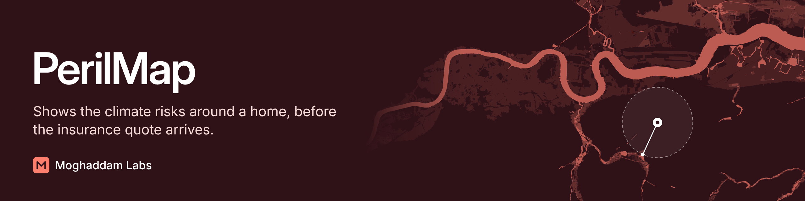

# PerilMap

PerilMap shows how exposed the area around a home is to climate-related perils, before the insurance
quote arrives. Find your postcode, mark your home on the map, and get clear risk bands and
plain-English explanations.

> **Status: in development.** The API is live and the website is being built. The website isn't public
> yet.

**Guidance only.** Results will not be an insurance quote, survey or financial advice. They describe
risk to an area of land, not whether a particular property will flood.

## Planned scope

- **England first, starting with London.** Each region is a plug-in, so the core never hard-codes one.
- **Flooding:** rivers and sea, and surface water, with the distance to the nearest zone in each band.
- **Subsidence:** a London-wide explainer, not a rating for each home. The free national data isn't suitable for local use.
- **Heat:** how an area's modelled average summer temperature compares across London, not a risk rating.

Groundwater and reservoir flooding won't be covered at launch, and the app will say so plainly.

## How the code is organised

- `perilmap/core`: the region-agnostic core. It finds the region for a location and gathers a result
  from each peril. It knows nothing about any real place, and a test enforces that.
- `perilmap/regions/london`: the London plug-in. It reads the flood and heat files and supplies each
  result's wording, sources and links. The wording all sits in `wording.py`, so it's easy to review.
- `perilmap/api`: the web API in front of the core.
- `web`: the website, built with Next.js. Its colours, patterns and components are its design system.
- `data_test`: builds and checks the flood and heat data.

Adding a region or peril means writing a plug-in, not changing the core. Each plug-in returns a result
that must say what it means, how sure it is and what someone can do next, and must credit its sources.
A gap in the data can't carry a number, so it can never look like a low risk.

## Run the API

The API reads the built flood and heat files from the `grids/` folder.

```bash
PERILMAP_SHOW_DOCS=true uvicorn perilmap.api.main:app --no-access-log --port 8000
```

Then try it from another terminal window:

```bash
curl -X POST http://127.0.0.1:8000/v1/assessments \
  -H "Content-Type: application/json" \
  -d '{"latitude": 51.5074, "longitude": -0.1278}'
```

With `PERILMAP_SHOW_DOCS=true`, interactive docs are at `http://127.0.0.1:8000/docs`. They're off by
default.

| Endpoint | What it does |
|---|---|
| `POST /v1/assessments` | Takes a latitude and longitude, and returns a result for each peril |
| `POST /v1/postcodes/lookup` | Takes a postcode, and returns its position through postcodes.io |
| `GET /health` | Says the API is running |

| Environment variable | What it does | Default |
|---|---|---|
| `PERILMAP_DATA_DIR` | Folder holding the built data files | `grids` |
| `PERILMAP_ALLOWED_ORIGINS` | Comma-separated websites allowed to call the API | None |
| `PERILMAP_TRUST_FORWARDED_FOR` | Use the proxy's client address header for rate limiting | Off |
| `PERILMAP_SHOW_DOCS` | Show the interactive docs | Off |
| `PERILMAP_CLIENT_RATE_LIMIT` | Requests per minute for each visitor | 30 |
| `PERILMAP_TOTAL_RATE_LIMIT` | Requests per minute across all visitors | 300 |

### Privacy

- Locations and postcodes are only accepted in request bodies, never in web addresses.
- Run the server with `--no-access-log`. The app doesn't log locations or postcodes, and error replies
  don't repeat them.
- Cloud Run's own request logs are turned off when deploying, because they'd keep visitors' internet
  addresses. Details are in the deployment guide.
- Rate limiting scrambles visitors' addresses with a key that's never saved, and forgets each one once
  its minute has passed.
- Postcode lookups go through our server, so postcodes.io sees the postcode but not who's searching.

## Run the website

You'll need Node.js 22. The website uses the live API unless you tell it otherwise.

```bash
cd web
npm ci
npm run dev
```

Open `http://localhost:3000`, and see every colour and component at `http://localhost:3000/design`.
To use your own copy of the API, copy `web/.env.example` to `web/.env.local` and follow its notes.

The site follows WCAG 2.2 AA. Flood levels always have a name and a pattern as well as a colour, and
coral is only ever a brand accent, so it never signals risk. A test checks every colour pair in
light and dark.

The website's API types are generated from the API itself. After changing the API's responses, run
this from the repo root, and commit the result:

```bash
python scripts/export_openapi.py
cd web && npm run api:types
```

## Deploy

See [the deployment guide](docs/deployment.md). The API runs on Google Cloud Run in London, with a
monthly spend cap, a single server and rate limiting.

## Run the data test

You'll need Python 3.11 or newer. The test doesn't use a database or need any credentials.

**1. Set up**

```bash
python3 -m venv .venv
source .venv/bin/activate
pip install -r requirements.lock
```

`requirements.lock` holds everything for development. The deployed app uses the smaller
`requirements.api.lock`.

**2. Download the data**

Download Greater London from each dataset as an ESRI Geodatabase, and unzip it into a `data/` folder.
Git ignores this folder. Surface water is too large to download in one go, so draw a few areas.
They can overlap.

- [Risk of Flooding from Rivers and Sea](https://environment.data.gov.uk/explore/96ab4342-82c1-4095-87f1-0082e8d84ef1?download=true), layer `rofrs_4band`
- [Risk of Flooding from Surface Water](https://environment.data.gov.uk/explore/b5aaa28d-6eb9-460e-8d6f-43caa71fbe0e?download=true), layer `rofsw`
- [Social and physical risk variables](https://cityhall.maps.arcgis.com/home/item.html?id=bc06d80731f146b393f8631a0f98c213), as a File Geodatabase

The heat step keeps only the temperature, borough name and area shape. The source's social measures,
such as income and ethnicity, are never read into PerilMap.

**3. Build the grid files and measure them**

Replace the paths with your own. List every download for a dataset in the same command.

```bash
python -m data_test inspect data/*.gdb
python -m data_test build rivers_and_sea data/rofrs_4band.gdb
python -m data_test build surface_water data/rofsw_1.gdb data/rofsw_2.gdb
python -m data_test coverage
python -m data_test heat data/GLA_ClimateRiskVariables.gdb
python -m data_test measure
```

The grid and heat files go in `grids/`, and the report goes in `reports/flood-data-test.md`. Each build prints
a coverage map, so you can spot any part of London that was missed.

The `coverage` command checks surface water against the official London boundary and updates
`perilmap/regions/london/reference/no_data_squares.csv`. Those squares show No data, because the files can't prove
whether they were downloaded. `measure` fails if that list no longer matches the grid.

| Where the pin is | Result shown |
|---|---|
| Outside the London boundary | Not available here yet |
| In a blank surface water square | No data |
| Within the search radius of a blank square or London's edge | Surface water result, marked as may be incomplete |
| Anywhere else in London | Full result |

## Run the tests

```bash
ruff check .
ruff format --check .
pytest
```

For the website, from the `web` folder:

```bash
npm run format:check
npm run lint
npm run typecheck
npm test
npm run build
npx playwright install chromium
npm run test:e2e
```

## Data sources

| Source | Publisher | Licence |
|---|---|---|
| [Risk of Flooding from Rivers and Sea](https://www.data.gov.uk/dataset/943d2bbb-aa08-45d1-96cb-42556cd01d94/risk-of-flooding-from-rivers-and-sea2) | Environment Agency | [Open Government Licence v3.0](https://www.nationalarchives.gov.uk/doc/open-government-licence/version/3/) |
| [Risk of Flooding from Surface Water](https://www.data.gov.uk/dataset/risk-of-flooding-from-surface-water3) | Environment Agency | [Open Government Licence v3.0](https://www.nationalarchives.gov.uk/doc/open-government-licence/version/3/) |
| [Climate Risk Mapping, mean air temperature](https://data.london.gov.uk/dataset/climate-risk-mapping) | Greater London Authority, Bloomberg Associates and Arup | [Open Government Licence v3.0](https://www.nationalarchives.gov.uk/doc/open-government-licence/version/3/) |
| [GeoSure 5 km hex grid, shrink-swell](https://www.bgs.ac.uk/datasets/bgs-geosure-5-km-hex-grid/) | British Geological Survey | Open Government Licence |
| [Postcode lookup](https://postcodes.io/) | postcodes.io | Credited in each lookup reply |
| [Greater London boundary](https://data.london.gov.uk/dataset/statistical-gis-boundary-files-london) | Greater London Authority | [Open Government Licence v2.0](https://www.nationalarchives.gov.uk/doc/open-government-licence/version/2/) |

© Environment Agency copyright and/or database right 2025. All rights reserved.

Contains National Statistics data © Crown copyright and database right [2015].

Contains Ordnance Survey data © Crown copyright and database right [2015].

## Licence

Proprietary. The source is public to view, but no rights are granted to copy, change or use it. See
[LICENSE](LICENSE).

---

Created by **Shaz Moghaddam** · London
[Website](https://shazmoghaddam.github.io/) · [LinkedIn](https://www.linkedin.com/in/shazmoghaddam/)
